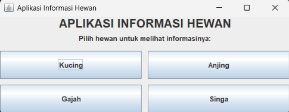
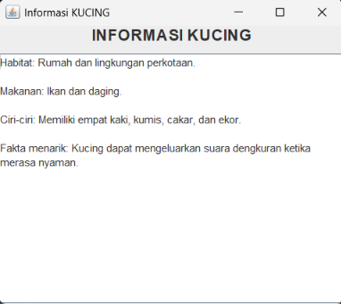

# Aplikasi Informasi Hewan

Aplikasi Informasi Hewan adalah program berbasis GUI (Graphical User Interface) yang dibuat menggunakan Java Swing. Program ini menampilkan pilihan beberapa hewan. Ketika pengguna menekan tombol salah satu hewan, program akan membuka jendela baru yang berisi informasi mengenai hewan tersebut.

## Tampilan Program

### 1. Tampilan Utama

Berikut adalah tampilan awal aplikasi yang menampilkan judul dan empat pilihan hewan, yaitu Kucing, Anjing, Gajah, dan Singa.



### 2. Tampilan Informasi Hewan

Ketika tombol hewan dipilih, aplikasi akan menampilkan jendela baru yang berisi informasi mengenai hewan tersebut. Contoh berikut adalah jendela informasi Kucing.



## Fitur

- Menampilkan empat pilihan hewan: Kucing, Anjing, Gajah, dan Singa.
- Membuka jendela informasi baru ketika tombol hewan diklik.
- Menampilkan nama dan deskripsi/informasi dari hewan yang dipilih.
- Memungkinkan jendela informasi ditutup tanpa menutup aplikasi utama.

## Teknologi yang Digunakan

- **Bahasa pemrograman:** Java
- **Library GUI:** Java Swing
- **Layout Manager:** `BorderLayout` dan `GridLayout`
- **Event Handling:** `ActionListener`

## Struktur Komponen GUI

Program menggunakan beberapa komponen GUI berikut:

| Komponen | Fungsi |
|---|---|
| `JFrame` | Membuat jendela utama dan jendela informasi hewan. |
| `JPanel` | Mengelompokkan komponen-komponen GUI. |
| `JLabel` | Menampilkan judul dan teks instruksi. |
| `JButton` | Menyediakan tombol pilihan hewan. |
| `JTextArea` | Menampilkan informasi hewan dalam bentuk teks. |
| `JScrollPane` | Menyediakan area gulir untuk teks informasi. |
| `BorderLayout` | Mengatur posisi panel pada jendela. |
| `GridLayout` | Menyusun komponen dalam bentuk baris dan kolom. |
| `ActionListener` | Menangani aksi ketika tombol hewan diklik. |

## Struktur Program

- **Top Level Container:** Kelas `InformasiHewan` yang mewarisi `JFrame` sebagai jendela utama aplikasi.
- **Intermediate Container:** `JPanel` untuk mengelompokkan komponen-komponen GUI.
- **Atomic Components:** `JButton`, `JLabel`, dan `JTextArea` sebagai komponen antarmuka.
- **Layout Classes:** `BorderLayout` dan `GridLayout` untuk mengatur tata letak komponen.
- **Event Listener:** `ActionListener` dengan override method `actionPerformed()` untuk merespons klik tombol.

## Cara Menjalankan Program

Pastikan Java Development Kit (JDK) sudah terpasang di komputer.

1. Simpan file kode dengan nama `InformasiHewan.java`.
2. Buka terminal atau Command Prompt pada folder tempat file tersebut disimpan.
3. Kompilasi program dengan perintah:

   ```bash
   javac InformasiHewan.java
   ```

4. Jalankan program dengan perintah:

   ```bash
   java InformasiHewan
   ```

## Cara Menggunakan

1. Jalankan program.
2. Pilih salah satu tombol hewan: **Kucing**, **Anjing**, **Gajah**, atau **Singa**.
3. Jendela baru akan terbuka dan menampilkan informasi hewan yang dipilih.
4. Tutup jendela informasi untuk kembali ke jendela utama.
